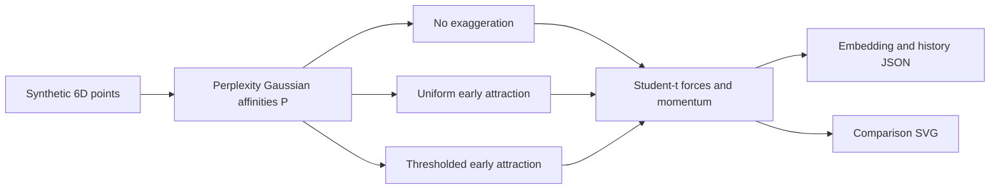

# t-SNE early exaggeration

Compare three attraction schedules in a small, exact NumPy t-SNE implementation:
no exaggeration, ordinary uniform early exaggeration, and an illustrative
threshold-based variant. The same synthetic 75-point, six-dimensional dataset,
joint affinities, initialization and optimizer settings feed every run. A JSON
file records the embeddings and optimization history; an SVG shows the results.

Early exaggeration temporarily strengthens attraction between nearby points.
The selective variant strengthens only pairs with `P[i,j] > threshold` and
multiplies all remaining pairs by an explicit `understate` factor. This is an
experiment, not a promise that selective exaggeration improves every dataset.
Labels color the plot only and never enter affinity calculation or optimization.

## Run

Requires Python 3.10+ and NumPy. No downloads, services, keys or GPU are needed.

```console
python -m venv .venv
python -m pip install -r requirements.txt
python demo.py
python demo.py --threshold 0.0002 --exaggeration 8 --understate 0.3
python -B -m unittest discover -s tests -v
```

Activate your virtual environment before installation if using one. Outputs are
`artifacts/comparison.json` and `artifacts/comparison.svg`; open the SVG in a
browser or image viewer. `--output PATH` selects another directory. Generated
artifacts are ignored by Git. CLI errors return a nonzero exit code.

## Code map

| File | Responsibility and connections |
| --- | --- |
| `affinities.py` | Validates inputs, computes exact pairwise distances, fits one Gaussian precision per row by entropy search, and symmetrizes the probabilities. |
| `optimizer.py` | Defines validated settings, chooses early-phase attraction weights, computes Student-t repulsion and the exact gradient, and runs seeded momentum updates. Receives `P` from `affinities.py`. |
| `demo.py` | Creates seeded synthetic inputs, runs all three schedules, writes comparison JSON and a standalone SVG. Imports the affinity and optimizer functions. |
| `tests/test_tsne.py` | Checks affinity normalization/perplexity, finite-difference gradients for all three schedules, threshold equality, phase transitions, deterministic centered optimization and CLI artifacts. |
| `requirements.txt` | Declares the NumPy dependency. |
| `.gitignore` | Excludes environments, Python caches and generated artifacts. |



## Mathematics and phase changes

High-dimensional conditionals are Gaussian probabilities with self-probabilities
zero. Each row's precision is fitted to the requested perplexity by binary
search; `P = (conditional + conditional.T)/(2*n)` is symmetric and sums to one.
Duplicate points can make a target perplexity unattainable; they still produce
a valid finite distribution. All-pairs storage and computation are quadratic,
so this implementation is intended for small examples.

Let `nu[i,j] = 1/(1 + squared_distance(y[i],y[j]))`, with zero diagonal, and
`Q = nu / sum(nu)`. During early iterations the attractive weights `W` are:

| Mode | Early `W[i,j]` |
| --- | --- |
| `none` | `P[i,j]` |
| `standard` | `exaggeration * P[i,j]` |
| `selective` | `exaggeration * P[i,j]` above the threshold, otherwise `understate * P[i,j]` |

At iteration `exaggeration_steps`, every mode restores `W=P`. `W` is deliberately
**not normalized**: normalizing a uniformly exaggerated matrix would cancel the
effect. The force is `4 * sum_j((W-Q)[i,j] * nu[i,j] * (y[i]-y[j]))`.

For arbitrary symmetric `W`, that gradient corresponds to the energy
`sum(W * log(1 + squared_distance)) + log(sum(nu))`. It does **not** correspond
to `KL(W||Q)` when `W` has nonunit mass. With `W=P`, the energy differs from
ordinary `KL(P||Q)` by a constant. Each logged `kl_original_p` is calculated
against the original normalized `P`, including during early iterations, so
the diagnostic uses the same definition across all modes.

The optimizer uses adaptive gains, momentum and recentering. This exact example
does not implement Barnes-Hut trees, FFT acceleration or a transform for unseen
points. The objective is nonconvex; seeds, perplexity and learning rate matter.
Panel scales are independent, and apparent cluster area or distance is not a
quantitative comparison of original high-dimensional distances.

## References

- [Original t-SNE paper, equations 4–5 and early exaggeration](https://jmlr.org/papers/volume9/vandermaaten08a/vandermaaten08a.pdf)
- [scikit-learn TSNE parameter documentation](https://scikit-learn.org/stable/modules/generated/sklearn.manifold.TSNE.html)
- [Open-source scikit-learn t-SNE implementation](https://github.com/scikit-learn/scikit-learn/blob/main/sklearn/manifold/_t_sne.py)

The thresholded schedule is an explicitly labeled experimental extension. The
references describe standard t-SNE and ordinary early exaggeration; they are
not evidence that this selective schedule is universally better.
